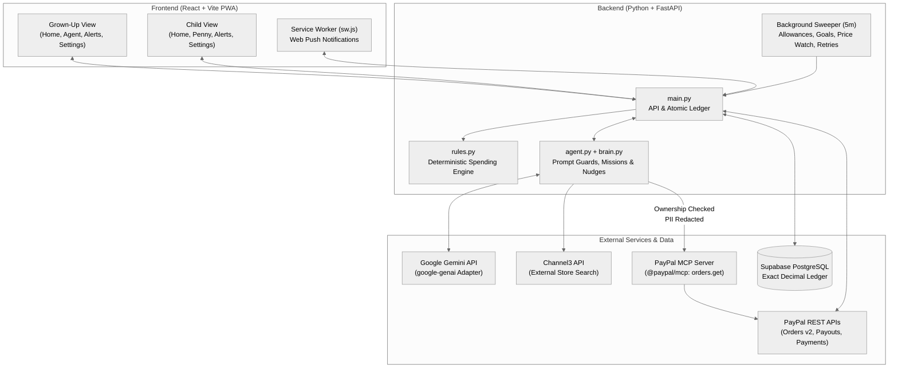

# Stash
**Family Money Management & Rule-Bounded AI Shopping Assistant (`FastAPI` · `React` · `PayPal` · `Gemini`)**

[Overview](#overview--problem) · [Core Features](#core-features) · [Architecture](#system-architecture) · [PayPal & Ledger](#paypal--ledger-mechanics) · [AI Safety](#ai-architecture--safety-guards) · [Setup](#setup--configuration) · [Deployment](#free-tier-deployment) · [Testing & Limits](#testing--mvp-limits)

---

## Overview & Problem

Kids learn very little about financial trade-offs when spending is just an invisible card swipe, while parents lack a safe way to grant children real purchasing power without handing over unrestricted payment credentials. As AI shopping agents become common, that risk compounds: an autonomous agent with a payment method and no limits is dangerous, and an agent that cannot explain its decisions teaches nothing.

**Stash** places a deterministic **backend rules engine, an approval workflow, and plain-language explanations** between an AI shopping assistant (**Penny**) and real money:
* **Parents ("Grown-ups")** fund a family balance via **PayPal Checkout**, configure per-child spending rules, set weekly allowances, and incentivize savings goals with percentage match bonuses.
* **Children** manage their spending wallet and savings pot, shop via natural language or photo attachments with **Penny** (powered by **Google Gemini**), and learn budgeting within hard guardrails enforced strictly by the server.
* **Merchant payouts, top-up refunds, and read-only order verification** run through **PayPal REST APIs** and **PayPal's official MCP server (`@paypal/mcp`)**.


---

## System Architecture



### Repository & Module Structure

| Component / File | Responsibility |
| :--- | :--- |
| `backend/main.py` | FastAPI endpoints, atomic database ledger transactions, and the 5-minute background sweeper task. |
| `backend/rules.py` | Pure, deterministic spending rules engine (per-purchase caps, weekly budgets, approval thresholds, store allowlists, account freeze). |
| `backend/agent.py` | Penny's system prompt assembly, role-scoped tool definitions, memory management, and server-side safety guards. |
| `backend/brain.py` | Background AI judgment layer for shopping mission basket ranking, price-drop explanations, and behavioral financial nudges. |
| `backend/gemini.py` | Provider adapter around the `google-genai` SDK keeping message shapes decoupled from the core agent loop. |
| `backend/paypal.py` | PayPal REST client handling Orders v2 checkout/capture, Payouts, Refunds, order lookups, and webhook signature verification. |
| `backend/paypal_mcp.py` | Read-only bridge to `@paypal/mcp` (`orders.get`), enforcing ownership checks and stripping PII before returning status to the model. |
| `backend/push.py` & `gen_vapid.py` | Standard Web Push notification dispatcher and VAPID key generator. |
| `backend/schema.sql` | PostgreSQL schema (`profiles`, `rules`, `products`, `purchases`, `goals`, `missions`, `proposals`, `alerts`, `audit`, `pay_orders`, `refunds`, `push_subs`, `chat_messages`). |
| `frontend/src` & `public/sw.js` | Mobile-first React + Vite web application with role-aware routing, light/dark modes, and Service Worker push handling. |

---

## Core Features

### 1. Accounts, Wallets & Deterministic Spending Rules
* **Role-Aware Accounts:** Grown-ups register with a name and password and create child accounts from the Home screen with a username, PIN, and custom limits. Children cannot self-register.
* **Funding & Wallets:** Grown-ups fund their Stash balance via PayPal Checkout. Every transfer to a child (one-off top-ups, weekly allowances, and savings bonuses) draws from this parent balance.
* **Two-Way Child Savings:** Each child has a spending wallet and a visual piggy-bank savings pot. Children can move funds freely between their wallet and savings in either direction; no other user can touch a child's savings.
* **Server-Enforced Rules:** Grown-ups configure a maximum per-purchase amount, a weekly budget, an approval threshold (above which purchases pause for parent sign-off), an allowed partner-store list, and a one-tap account freeze. **All rules are enforced by the backend (`rules.py`), never trusted to the AI.**

### 2. Shopping with Penny (Conversational & Multimodal)
* **Guided Discovery:** Users tell Penny what they want (or attach a photo from their camera/library). Penny asks brief clarifying questions if critical details (size, budget, quantity) are missing, searches the catalog, and recommends up to three options.
* **Partner vs. External Stores:** For partner-store items, Penny quotes the exact price and remaining wallet balance, requiring an explicit `"yes"` before purchasing. For external stores (via Channel3), Penny provides a direct link to purchase on the merchant's site.
* **Persistent 24-Hour Context:** The last 24 hours of conversation (up to 60 messages) and structured tool notes (product IDs, quoted prices, recent purchases) persist on the server across reloads. Users can clear context anytime via **New chat**.

### 3. Orders, Cancellations & Top-Up Refunds
* **Order Lifecycle:** Partner purchases track through a visible timeline (`placed` → `approved` → `paid` → `shipped` → `delivered`) in both Chat and Home, with Web Push notifications at every stage.
* **Order Cancellations:** Undelivered orders can be cancelled via button or chat (after confirming `"yes"`). Cancelling a paid order refunds the Stash wallet; cancelling a pending approval withdraws the request. Both parent and child are notified. *(Note: Cancelling credits the Stash wallet only; it does not recall a completed PayPal merchant payout.)*
* **PayPal Top-Up Refunds & Status Lookups:** Grown-ups can ask Penny *"Did my top-up go through?"* (verified via PayPal's MCP server) or request a refund of unspent balance from top-ups under 180 days old. Penny files a proposal; money only moves when the grown-up taps **Send refund** in Notifications.

### 4. Automated Allowances, Savings Bonuses & Background Intelligence
* **Savings Goals & Match Bonuses:** Children or parents can create named savings goals with a target amount. Grown-ups receive a notification and can attach an optional **0%–100% match bonus** via a slider. Once the target is reached, savings plus the parent-funded bonus transfer automatically to the child's wallet (or queue safely until the parent tops up).
* **Weekly Allowances:** Automatically transferred every week from the grown-up's balance to the child's wallet, with automatic retry if the parent balance is temporarily low.
* **Shopping Missions:** A prompt like *"get an art kit and a soccer ball under $30"* launches an asynchronous background mission. Stash filters partner items by store/spending rules, uses `brain.py` to select optimal items (falling back to the cheapest valid option if AI is disabled), trims the basket to fit budgets, and sends a single batch approval request.
* **Price Watching & Order Recovery:** Stash monitors prices on goal-linked partner items—offering to lower goal targets on price drops or executing an **auto-buy** if the price hits a parent-configured threshold and savings cover it. If a partner reports a cancellation or delay, Stash automatically refunds or proposes a rule-compliant replacement swap.
* **Transparent Nudges:** When allowances arrive, goals stall for a week, or a child hits their per-purchase limit three times in a week, Stash generates a gentle savings or limit-adjustment nudge. Every suggestion includes a **"How I decided"** audit trace showing exact system steps and verifying all dollar figures in code.

---

## PayPal & Ledger Mechanics

| Flow | PayPal Integration | Reliability & Safety Mechanism |
| :--- | :--- | :--- |
| **Adding Funds** | **Orders v2 API** + Webhooks | Captures are claimed atomically in Postgres with a stable `PayPal-Request-Id` to prevent double-crediting on refreshes/retries. Signature-verified `CHECKOUT.ORDER.APPROVED` webhooks capture orders even if the browser tab closes. |
| **Partner Purchases** | **Payouts API** | Debits the child's wallet atomically and dispatches a payout to `MERCHANT_PAYOUT_EMAIL`. If the PayPal call fails, the wallet debit rolls back immediately. |
| **Top-Up Refunds** | **Payments API** | Deducts unspent parent balance inside the same DB transaction that records the refund, using an idempotent request ID. Ambiguous network failures retry every few minutes for up to 24 hours before flagging for manual review. |
| **Order Status Lookup** | **PayPal MCP Server** (`@paypal/mcp`) | Spawned with **only** the read-only `orders.get` tool and a short-lived token. The backend verifies database ownership first, strips payer PII (names, emails, addresses), and passes only `status`, `amount`, and `date` to Penny. Falls back gracefully to PayPal REST API → local DB record. |

**Internal Ledger Integrity:**
All internal transfers (parent balance ↔ child wallet ↔ child savings) execute as atomic conditional PostgreSQL updates (`WHERE balance >= amount`) using exact decimal types, making negative balances impossible even under concurrent requests. Without PayPal keys, the system runs in an isolated simulator mode (demo top-ups can only be refunded in demo mode).

---

## AI Architecture & Safety Guards

Penny uses **Google Gemini (`google-genai`)** with strict separation between conversational fluency and financial authority:

1. **Zero AI Authority Over Rules:** The prompt instructs Penny on context, but **the backend enforces every rule on every transaction**.
2. **Anti-Hallucination & Confirmation Locks:**
   * A purchase tool call only succeeds if the product was actually shown to that user recently (within 15 minutes of search or 30 minutes in saved chat), the price matches what was quoted, and the user's latest message contains an explicit confirmation (`"yes"`).
   * In `brain.py`, the model may only pick from pre-validated product IDs; unknown IDs are discarded, dollar figures in generated text must match app-supplied numbers, and suggested nudge transfers are clamped in code to at most 50% of the wallet.
3. **Prompt Injection & Privacy Defenses:**
   * Product descriptions, third-party store titles, and text inside user-uploaded photos are sanitized and treated strictly as untrusted data, never instructions.
   * Child searches are filtered against unsafe categories prior to execution.
   * Tools are strictly role-scoped (children never receive top-up or refund tools) and act only on the authenticated user's session.
4. **Graceful Degradation:** Setting `PENNY_AI=off` disables background AI ranking and nudge copywriting while keeping all deterministic mission, price-watch, and rule workflows fully operational.

---

## Production Buying Workflow vs. MVP Scope

Steps **1–6** run live in this MVP; steps **7–8** use simulated partner fulfillment for mock catalog stores:

1. **Parent Funds Account:** Grown-up approves PayPal Checkout → captured atomically → Stash balance increases.
2. **Rules & Allowance Configured:** Grown-up sets limits and optional weekly allowance.
3. **Discovery:** Child asks Penny for an item (via text or photo) → Penny clarifies and searches.
4. **Quote & Confirmation:** Penny presents up to 3 options with exact prices and remaining wallet impact, asking for a `"yes"`.
5. **Backend Rule Evaluation:** `rules.py` evaluates the request → **Blocked** (with plain reason), **Queued for Approval**, or **Allowed**.
6. **Execution:** Upon approval, the child's wallet is debited atomically and PayPal Payouts pays the merchant.
7. **Fulfillment Tracking:** Order progresses from `placed` → `approved` → `paid` → `shipped` → `delivered` with push notifications (cancellable until delivered).
8. **External Stores:** For non-partner items, Penny provides a link for checkout on the merchant's site.

---

## Setup & Configuration

### Prerequisites
* **Python 3.10+** and **Node.js 18+** (`npx` is required to run the `@paypal/mcp` server)
* A **Supabase** PostgreSQL project

### Quick Start

```bash
# 1. Database Setup
# Open the Supabase SQL Editor, run backend/schema.sql, and copy the Session Pooler URI.

# 2. Backend Environment & VAPID Keys
cp backend/.env.example backend/.env
python -c "import secrets; print(secrets.token_urlsafe(48))"  # Set as SECRET_KEY in .env
python backend/gen_vapid.py                                    # Paste the 3 VAPID lines into .env

# 3. Start Backend Server (http://localhost:8000)
cd backend
pip install -r requirements.txt
uvicorn main:app --reload

# 4. Start Frontend Dev Server (http://localhost:5173)
cd ../frontend
npm install
npm run dev
```

* **Default Demo Accounts:** Sign in as `Sam` (grown-up) or `Maya` (child) using password `demo`. Replace or delete seeded accounts before public sharing.
* **Health Check:** Visit `GET /health` on the backend to inspect which integrations (Database, Gemini, PayPal REST, PayPal MCP, Web Push) are active.

<details>
<summary><b>Environment Variables Reference (<code>backend/.env</code>)</b></summary>
<br/>

| Variable | Required | Description |
| :--- | :---: | :--- |
| `DATABASE_URL` | **Yes** | Supabase PostgreSQL Session pooler connection string. |
| `SECRET_KEY` | **Yes** | Long random secret for signing auth tokens (server refuses to start without it). |
| `GEMINI_API_KEY` | No* | Enables Penny chat and `brain.py` judgment (`GOOGLE_API_KEY` also accepted). |
| `GEMINI_MODEL` | No | Overrides default model defined in `gemini.py`. |
| `GEMINI_THINKING_LEVEL` | No | Optional reasoning budget (`low`, `medium`, `high`). |
| `PENNY_AI` | No | Set to `off` to disable background AI ranking/nudge copywriting and use pure rules. |
| `PAYPAL_CLIENT_ID` / `PAYPAL_SECRET` | No* | Enables live/sandbox PayPal Checkout, Payouts, Refunds, and lookups (simulated if omitted). |
| `PAYPAL_ENV` | No | `sandbox` (default) or `live`. |
| `PAYPAL_MCP` / `PAYPAL_MCP_PACKAGE` | No | Set `PAYPAL_MCP=off` to bypass MCP and use REST; `PAYPAL_MCP_PACKAGE` overrides pinned package. |
| `PAYPAL_WEBHOOK_ID` | No | Enables signature-verified capture on `POST /webhooks/paypal`. |
| `MERCHANT_PAYOUT_EMAIL` | No | Sandbox/live PayPal account receiving partner payouts (simulated if empty). |
| `APP_URL` / `ALLOWED_ORIGINS` | No | Frontend return URL for PayPal redirects and comma-separated CORS origins. |
| `CHANNEL3_API_KEY` | No | Enables external store search and photo search. |
| `VAPID_PUBLIC_KEY` / `PRIVATE_KEY` / `SUBJECT` | No | Enables Web Push notifications (`VAPID_SUBJECT` must be a valid `mailto:` email). |
| `CRON_KEY` | No | Protects `/internal/partner-event`, `/internal/price`, and `/internal/settle-all`. |

</details>

---

## Free-Tier Deployment

Stash can be hosted end-to-end on free cloud tiers (or demoed locally via a Cloudflare Quick Tunnel):

* **Frontend:** Deploy `frontend/dist` (`npm run build`) to **Vercel**, **Netlify**, or **Cloudflare Pages** with `VITE_API` pointing to your backend URL.
* **Backend:** Deploy on **Render (Free Web Service)** using `backend/Dockerfile` (which bundles Python and Node.js). Run a **single worker process**, set health check path to `/health`, and configure `APP_URL` and `ALLOWED_ORIGINS`.
* **Database & Wakeups:** Use **Supabase Free Tier** (open the dashboard before demos to prevent inactivity pause). Use a free uptime monitor (e.g., UptimeRobot or cron-job.org hitting `/health` every 10 minutes) to prevent Render's 15-minute idle sleep and keep the internal 5-minute sweeper running.
* **Memory Guardrail (512 MB Limit):** If Render restarts due to memory pressure from running Python + the Node.js `@paypal/mcp` subprocess simultaneously, set `PAYPAL_MCP=off` to fall back to the lightweight PayPal REST lookup.

---

## Testing & MVP Limits

### Running the Test Suite (150+ Tests)
```bash
cd backend
pip install -r requirements-dev.txt
pytest -q
```
* Covers the deterministic rules engine, mocked PayPal REST flows (checkout, capture, payouts, refunds), the MCP bridge (`fake_mcp_server.py`), the Gemini adapter, prompt/confirmation safety guards, and end-to-end API workflows on an isolated PostgreSQL instance.
* Pure unit test files (`test_checks.py`, `test_gemini.py`) can also run standalone via `pytest --noconftest`.
* If `pgserver` cannot install on your OS, point `TEST_DATABASE_URL` at an empty throwaway Postgres database *(warning: tests drop and recreate tables)*.

<details>
<summary><b>Known MVP Limitations & Pre-Launch Roadmap</b></summary>
<br/>

* **Authentication & Edge Security:** Uses username/password with 24-hour signed tokens and in-app rate limiting on login, chat, and cancellations. Production release requires edge rate limiting on sign-up, email verification, password reset, and parent KYC/identity verification.
* **Partner Catalog & Fulfillment:** Partner stores and shipping timelines are simulated via timers and `/internal/*` webhook endpoints. Production requires live merchant agreements or PayPal Agent Checkout plus real carrier webhooks.
* **Payout Reversals & Disputes:** Order cancellations credit the user's Stash wallet from Stash's ledger; they do not recall completed PayPal merchant payouts. Full merchant return/dispute pipelines and emailed receipts are not yet built.
* **Single-Process Memory State:** Concurrency locks, rate limiters, and recent product-view caches live in single-process memory. Scaling to multiple workers requires moving ephemeral state to Redis or Postgres.
* **Legal & Compliance Review:** Holding customer balances and serving children requires legal review for money-transmission compliance and children's data privacy (e.g., COPPA/GDPR-K), plus clear disclosure of the 24-hour rolling chat retention window.
</details>
